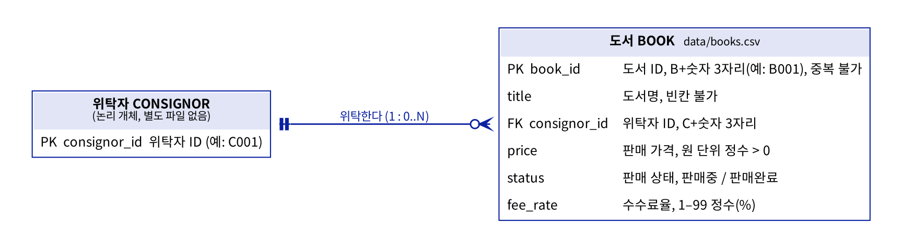
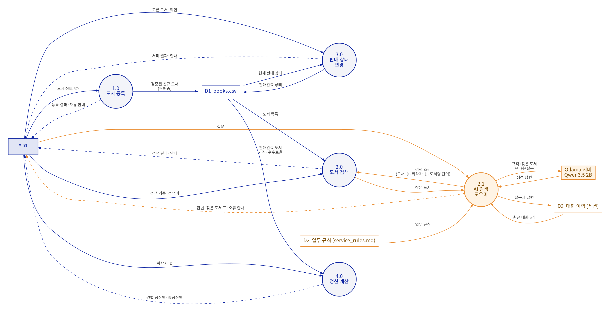
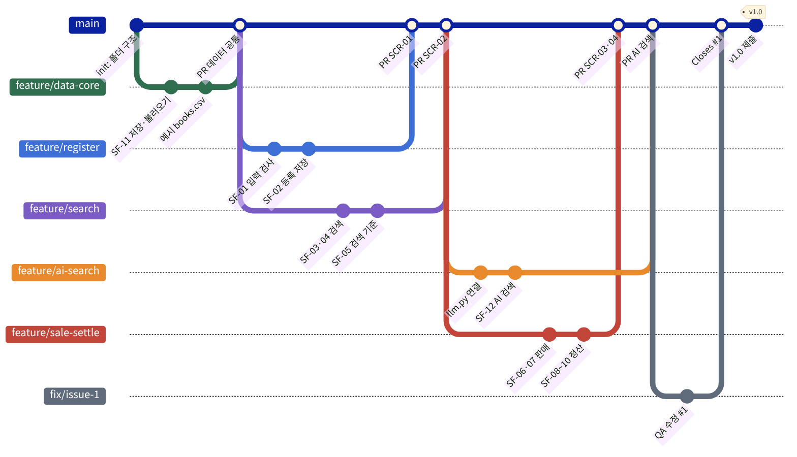
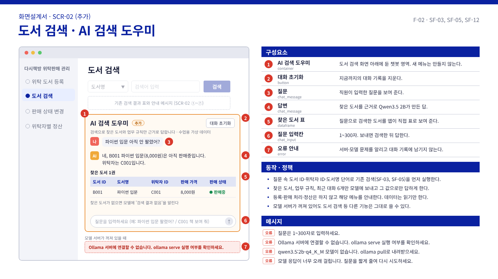
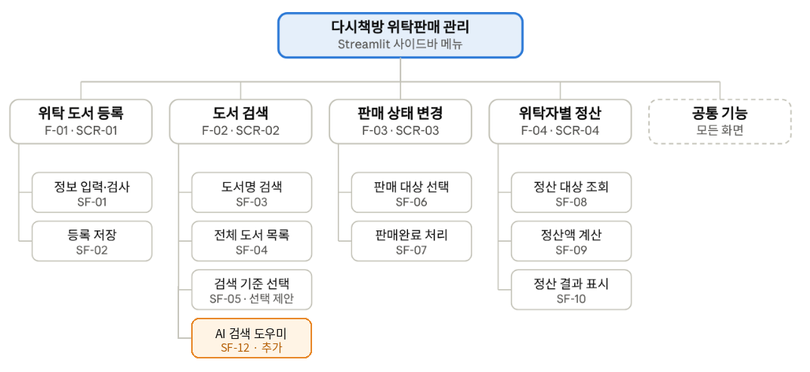
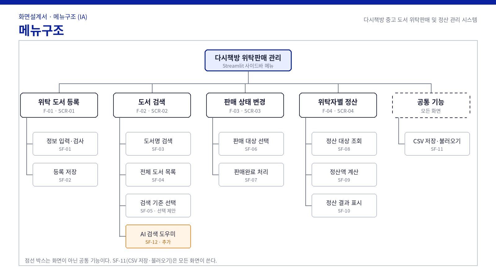

# 개발노트: 다시책방 위탁판매 관리

| 항목 | 내용 |
| --- | --- |
| 팀 | 3팀 이민혁(PM·통합), 강건우(데이터·등록·품질, AI 검색 도우미), 김찬빈(판매·정산) |
| 대상 | 4조 다시책방 RFP: 중고 도서 위탁판매·정산 관리 |
| 기간 | 2026년 11월 10일 – 11월 15일 (제출 기한 11월 17일) |
| GitHub | https://github.com/gunwoo-go0/dasibook-3team |
| 환경 | Python 3.11 이상, venv, Streamlit, pandas, CSV, Ollama + Qwen3.5 2B |

> **메모 · 추가** 노란 메모 상자는 이번에 추가한 AI 검색 도우미(SF-12) 관련 내용이다. 제안서에도 같은 부분에 메모를 달았다.

## 1. 파일 트리

```text
dasibook-3team/
├─ app.py                  시작 파일: 사이드바 메뉴 4개(IA), 첫 화면은 도서 검색(전체 목록)
├─ pages/
│  ├─ register.py          SCR-01 위탁 도서 등록      SF-01, SF-02
│  ├─ search.py            SCR-02 도서 검색           SF-03, SF-04, SF-05
│  │                       + AI 검색 도우미 영역      SF-12 (추가)
│  ├─ sale.py              SCR-03 판매 상태 변경      SF-06, SF-07
│  └─ settle.py            SCR-04 위탁자별 정산       SF-08, SF-09, SF-10
├─ core/                   화면과 분리한 업무 로직
│  ├─ common.py            공통 상수, 오류, 금액 표시
│  ├─ storage.py           SF-11 CSV 저장·불러오기
│  ├─ register.py          SF-01 입력 검사, SF-02 등록
│  ├─ search.py            SF-03 도서명 검색, SF-04 전체 목록, SF-05 검색 기준
│  ├─ sale.py              SF-06 판매 대상, SF-07 판매완료 처리
│  ├─ settle.py            SF-08 정산 대상, SF-09 정산액 계산, SF-10 결과 값
│  └─ ai_search.py         SF-12 질문에서 검색 조건을 찾아 기존 검색 실행 (추가)
├─ llm.py                  Ollama 연결과 답변 생성 (수업 예제 구조, 추가)
├─ smoke_test.py           모델 연결 확인 (추가)
├─ support/
│  └─ service_rules.md     AI 검색 도우미가 근거로 쓰는 업무 규칙 (추가)
├─ data/
│  └─ books.csv            예시 가상 데이터
├─ tests/                  pytest 자동 테스트
├─ ui.py                   화면 공통 도우미(도서 표, 메시지)
├─ .streamlit/config.toml  화면 설정
├─ .env.example            Ollama 주소·모델 이름 견본 (추가)
├─ .gitignore              .venv, .env 등 제외
├─ requirements.txt        실행 패키지와 버전
├─ requirements-dev.txt    테스트용 pytest
└─ README.md               설치·실행 방법, 출처·라이선스
```

- 화면(`pages/`)과 업무 로직(`core/`)을 나눴다. 도서 검색 화면과 AI 검색 도우미가 같은 검색 함수(`core/search.py`)를 쓴다.
- 앱을 켜면 도서 검색 화면이 먼저 열리고 전체 도서 목록을 보여 준다(IA 원칙: 도서 목록을 홈으로).
- `.env`와 `.venv`는 Git에 올리지 않는다.

> **메모 · 추가** `ai_search.py`, `llm.py`, `smoke_test.py`, `support/service_rules.md`, `.env.example`을 더했다.

## 2. DB 구조 (ERD)



| 열 | 뜻 | 규칙 |
| --- | --- | --- |
| book_id | 도서 ID | B+숫자 3자리(예: B001), 중복 불가 |
| title | 도서명 | 빈칸 불가 |
| consignor_id | 위탁자 ID | C+숫자 3자리(예: C001) |
| price | 판매 가격 | 원 단위 정수, 0보다 큼 |
| status | 판매 상태 | 판매중 / 판매완료 |
| fee_rate | 수수료율 | 1–99 정수(%) |

- 별도 DB 없이 `data/books.csv` 하나에 저장한다(RFP Ⅱ.2). 위탁자는 파일 없이 `consignor_id`로만 존재하는 논리 개체로 그렸다.
- 저장할 때는 임시 파일에 먼저 쓰고 바꿔 끼운다. 저장 중 문제가 생겨도 기존 파일은 깨지지 않는다.
- UTF-8(BOM)으로 저장해 엑셀에서 열어도 한글이 깨지지 않는다.
- AI 검색 도우미는 이 파일을 읽기만 한다.

## 3. DFD



| 번호 | 프로세스 | 입력 → 출력 | 자료 저장소 |
| --- | --- | --- | --- |
| 1.0 | 도서 등록 | 도서 정보 5개 → 등록 결과·오류 안내 | D1 쓰기 |
| 2.0 | 도서 검색 | 검색 기준·검색어 → 검색 결과·안내 | D1 읽기 |
| 2.1 | AI 검색 도우미 (추가) | 질문 → 답변·찾은 도서 표·오류 안내 | D2 읽기, D3 읽기·쓰기 |
| 3.0 | 판매 상태 변경 | 고른 도서·확인 → 처리 결과·안내 | D1 읽기·쓰기 |
| 4.0 | 정산 계산 | 위탁자 ID → 권별 정산액·총정산액 | D1 읽기 |

- 외부 개체: 직원, Ollama 서버(Qwen3.5 2B).
- 자료 저장소: D1 books.csv, D2 업무 규칙(`support/service_rules.md`), D3 대화 이력(브라우저 세션에만 두고 파일로 저장하지 않음).
- 2.1은 도서 데이터를 직접 읽지 않고 2.0 검색을 거쳐서만 받는다.

> **메모 · 추가** 2.1 AI 검색 도우미와 D2, D3, Ollama 서버를 주황색으로 더했다.

## 4. 브랜치 전략



| 브랜치 | 담당 | 내용 | 병합 조건 |
| --- | --- | --- | --- |
| main | 이민혁(병합) | 검증된 코드만 둔다. 직접 push하지 않는다. | — |
| feature/data-core | 강건우 | SF-11 저장·불러오기, 예시 CSV, 공통 모듈 | 앱이 켜지고 목록이 보임 |
| feature/register | 강건우 | SCR-01 위탁 도서 등록 (SF-01, SF-02) | 등록 정상·예외 확인 |
| feature/search | 이민혁 | SCR-02 도서 검색 (SF-03–SF-05) | 검색 정상·예외 확인 |
| feature/sale-settle | 김찬빈 | SCR-03 판매 상태 변경, SCR-04 정산 (SF-06–SF-10) | 판매·정산 정상·예외 확인 |
| feature/app-menu | 이민혁 | 사이드바 메뉴와 화면 통합 (app.py) | 메뉴 4개 이동 확인 |
| feature/ai-search | 강건우 | SF-12 AI 검색 도우미 (llm.py, smoke_test.py, 업무 규칙) | smoke_test 통과, AI 질문 확인 |
| fix/issue-번호 | 발견한 사람 | QA에서 찾은 문제 수정 | 재현 순서로 다시 확인 |
| docs/devnote | 강건우 | README, 개발노트 | PDF 확인 |

규칙

1. 모든 변경은 기능별 브랜치에서 하고 Pull Request로 main에 병합한다.
2. PR 본문에 기능 ID(SF-xx)와 확인한 정상·예외 결과를 적고, 다른 팀원 1명 이상이 검토한 뒤 병합한다.
3. 커밋 메시지는 `feat(SF-01): 입력 검사`, `fix(#3): 판매 후 선택 초기화`, `docs: DFD 추가`처럼 쓴다.
4. QA에서 찾은 문제는 GitHub Issue로 올리고 `fix/issue-번호` 브랜치에서 고친다. PR 본문에 `Closes #번호`를 적으면 병합할 때 Issue가 닫힌다.

> **메모 · 추가** AI 검색 도우미용 `feature/ai-search` 브랜치를 더했다.

## 5. AI 검색 도우미 (SF-12)

> **메모 · 추가** 수업 추가사항(기존 서비스에 오픈소스 AI 모델 챗봇을 넣고 기존 기능 중 하나 이상과 연동)에 따라 도서 검색 기능에 넣었다.

- 위치: 도서 검색 화면(SCR-02) 아래쪽. 새 메뉴는 만들지 않는다.
- 연동: 질문 속 도서 ID(B001), 위탁자 ID(C001), 도서명으로 기존 검색 함수(SF-03 도서명, SF-05 도서 ID·위탁자 ID)를 실행한다. 도서명은 전체 제목이 있으면 그 제목으로, 없으면 제목에 쓰인 단어로 찾는다. 찾은 도서는 최대 10권까지 모델에 넘기고 화면에도 표로 보여 준다.
- 모델에 보내는 순서: 시스템 메시지(역할과 금지 사항, 업무 규칙, 찾은 도서) → 최근 대화 6개 → 질문. 수업 예제 `llm.py`와 같은 구조다.
- 모델 설정: `qwen3.5:2b-q4_K_M`, temperature 0, think 끔, num_ctx 8192, num_predict 512, 응답 대기 180초.
- 하지 않는 것: 등록, 판매 처리, 정산, 송금. 데이터는 읽기만 하고 해당 메뉴를 안내한다.
- 오류 안내: 질문 길이(1–300자), 서버 미실행, 모델 없음, 시간 초과, 출력 한도, 빈 답변. 실패한 질문은 대화 기록에 남기지 않는다.
- 모델 서버가 꺼져 있어도 도서 검색 등 다른 기능은 그대로 쓸 수 있다.
- 확인 방법: `smoke_test.py`로 모델 연결을 먼저 확인하고, QA.md의 QA-19부터 QA-23까지로 화면에서 확인한다.



## 6. 업데이트된 자료

함께 낸 제안서 PDF에서 추가한 부분은 오른쪽 여백의 메모로 표시했다.

| 문서 위치 | 바뀐 내용 | 구분 |
| --- | --- | --- |
| 제안개요 | 세부 기능 12개(SF-01–SF-12), AI 검색 도우미 한 문장 | 추가·메모 |
| 서비스 기능 설계표 | SF-12 행 | 추가·메모 |
| 사용할 프레임워크, 작동 방법 | Ollama·Qwen3.5 2B, AI 작동 순서, 실행 순서 | 추가·메모 |
| IA | 설계 원칙 1줄, 사이트맵에 AI 검색 도우미(주황 상자), 각주 오타(SCV→CSV) 수정 | 추가·메모 |
| 화면설계서 | 메뉴구조 그림 갱신, SCR-02 AI 검색 도우미 화면 1장 | 추가·메모 |
| 요구사항 대응표 | AI-01 행 | 추가·메모 |
| 수행계획 | 다른 프로젝트 일정(12월 8일, 12월 15일)을 지우고 11월 15일 완료 일정으로 정정 | 수정 |
| WBS, R&R | AI 작업(1.4, 2.8)과 담당 | 추가·메모 |





## 7. Draft와 QA

- [Draft.md](Draft.md): 주요 화면·기능 초안이 IA와 요구사항을 얼마나 반영했는지, 빠지거나 다른 부분과 고칠 내용.
- [QA.md](QA.md): 직접 실행한 QA 결과표(25건, 화면은 `images/qa/`)와 수정사항 6건(GitHub Issue).
- QA-19~22는 PC에서 실제 Qwen으로 확인해 채웠다. Issue 번호·수정 PR·재테스트 결과와 QA-18(윈도우+엑셀)은 Issue 등록과 수정 뒤에 채운다.
